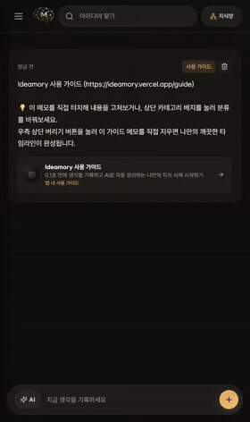
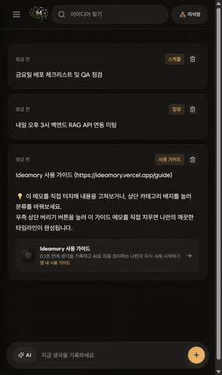
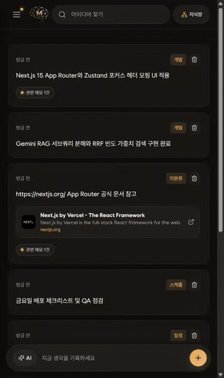
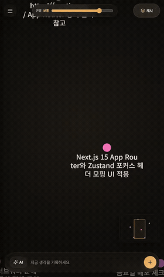
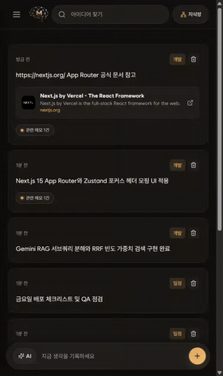
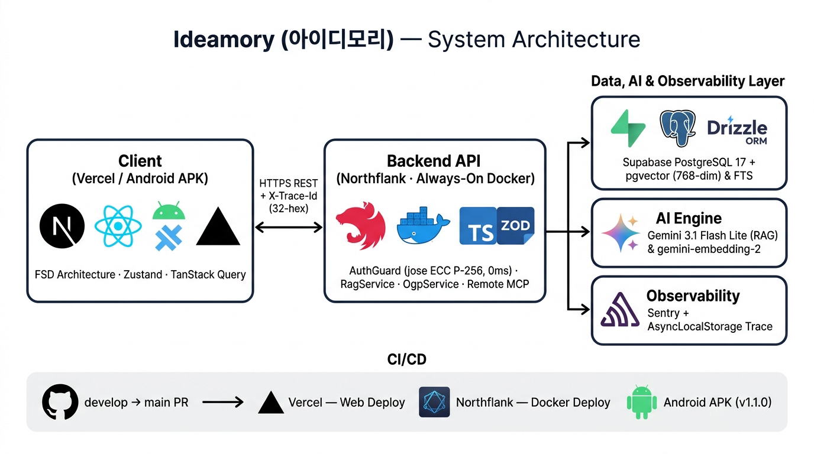

# Ideamory (아이디모리)

> **생각이 떠올랐을 때, 정리하지 말고 0.1초 만에 담아두세요.**
>
> 폴더·태그 정리의 강박을 없애고, **Gemini 768차원 임베딩 · 하이브리드 RAG · 제텔카스텐 지식망**이
> 메모를 자동으로 분류·연결·브리핑해 주는 **모바일 퍼스트 AI 지식 서재 (Memory Cache)** 입니다.

 

 

---

## 1. 한눈에 들어오는 핵심 엔지니어링 지표 (Key Metrics)

| 엔지니어링 핵심 지표 | 달성 수치 및 결과 | 적용 기술 및 아키텍처적 근거 |
| :--- | :--- | :--- |
| **앱 진입 및 캡처 레이턴시** | **0.1초 (0ms 체감)** | 가입 절차 없는 단말 고유 익명 세션(`guest_token`) 즉시 발급 `UUIDv7` 선할당 & TanStack Query 낙관적 UI |
| **백엔드 콜드 스타트 지연** | **0초 (Always-On)** | Northflank Docker 상시 구동 컨테이너 채택으로 서버리스 콜드 스타트 딜레이 완전 제거 |
| **토큰 검증 네트워크 오버헤드** | **0ms (로컬 인메모리)** | 무거운 Supabase SDK 대신 `jose` 라이브러리로 Supabase Auth ECC(P-256) JWKS 인메모리 서명 검증 |
| **OGP 크롤링 네트워크 부하** | **N:1 중복 제거 (14일 TTL)** | 1:1 종속 저장을 탈피한 `target_url` UNIQUE 기반 N:1 공유 캐시(`ogp_caches`) 및 자정 만료 스케줄러 |
| **분산 환경 추적 가시성** | **100% (End-to-End)** | W3C/Sentry 표준 32자리 Hex `X-Trace-Id` 발급·전파 `AsyncLocalStorage` + `@LogTrace()` + Drizzle SQL 전 계층 추적 |
| **자동화 & E2E 교차 검증** | **단위 128건 E2E Round 1~3 PASS** | 백엔드 `119/119` + 웹 `9/9` 단위 테스트 통과 프로덕션 Web ↔ API ↔ Supabase MCP `execute_sql` 3중 교차 검증 |

 

---

## 2. 핵심 인터랙션 라이브 데모 (Production Recordings)

> 프로덕션 환경(`https://ideamory.vercel.app`, 모바일 `390×844` 앱 뷰포트)에서 직접 검증·녹화한 핵심 기능 시연입니다.

| 01. 0.1초 퀵 캡처 & `@카테고리` | 02. AI 자동 분류 & OGP 링크 카드 | 03. AI 유사 카테고리 병합 |
| :---: | :---: | :---: |
|  |  |  |
| 문두 `@카테고리` 자동 분리 및 0ms 낙관적 UI 즉시 저장 [고화질 WebM](integration-tests/evidence/round-3/videos/01-quick-capture.webm) | 미분류 스켈레톤 선저장 ➔ AI 분류 · OGP 카드 자동 전환 [고화질 WebM](integration-tests/evidence/round-3/videos/02-ai-and-ogp.webm) | 사이드바 `병합` 배지 · 유사도 90% 배너 트랜잭션 기반 원자적 병합 [고화질 WebM](integration-tests/evidence/round-3/videos/03-category-merge.webm) |

| 04. 하이브리드 검색 & 연관 메모 | 05. 제텔카스텐 지식망 탐색 | 06. 썸존 `[AI]` RAG 단일 브리핑 |
| :---: | :---: | :---: |
|  |  |  |
| Tier 1 FTS + Tier 2 Vector 하이브리드 검색 및 1-Depth 필터 [고화질 WebM](integration-tests/evidence/round-3/videos/04-search-and-related.webm) | `react-force-graph-2d` 기반 연결 강도 실시간 조절 및 탐색 [고화질 WebM](integration-tests/evidence/round-3/videos/05-knowledge-graph.webm) | 화살표 포커스 헤더 · 1줄 결론+불릿 근거 메모 카드 실시간 연동 [고화질 WebM](integration-tests/evidence/round-3/videos/06-ai-rag-briefing.webm) |

 

---

## 3. 시스템 아키텍처 및 기술적 의사결정 (Tech Choices - Why)

 

### 기술 선택의 결정적 이유 (Why)

#### 1) 왜 무거운 Supabase SDK 대신 `jose` 오프라인 검증인가?
- 백엔드에서 `@supabase/supabase-js`로 매 요청을 검증하면 Supabase Auth 서버와 불필요한 네트워크 왕복이 발생합니다.
- ECC(P-256) JWKS 공개키를 인메모리에 캐싱하고 `jose`로 로컬 서명 검증만 수행해 **인증 오버헤드를 0ms**로 압축했습니다.

#### 2) 왜 Next.js Server Actions 대신 NestJS 순수 REST API로 일원화했는가?
- AI 파이프라인 · OGP 크롤링 · DB 트랜잭션까지 Server Actions에 함께 넣으면 프론트엔드와 백엔드 경계가 섞여 유지보수 공수가 크게 늘어납니다.
- 백엔드 책임을 NestJS REST API로 분리함으로써 **Capacitor 정적 Export**와 **외부 AI 에이전트용 Remote MCP 규격**까지 깔끔하게 일원화했습니다.

#### 3) 왜 Prisma 대신 Drizzle ORM + `postgres.js`인가?
- `pgvector` 코사인 거리 연산자(`<=>`), `to_tsvector` FTS, 카테고리 매칭 등 **벡터 DB 기반의 복잡한 네이티브 SQL 쿼리**가 핵심입니다.
- 추상화 계층의 제약 없이 SQL을 정밀하고 가볍게 제어하기 위해 Drizzle ORM을 선택했습니다.

#### 4) 왜 채팅형 RAG 스레드가 아닌 'Single-Briefing Replace'인가?
- Ideamory AI 검색의 목적은 채팅으로 메모를 고도화하는 것이 아니라 **필요한 메모를 가장 빠르게 찾아 핵심을 파악하는 것**입니다.
- 따라서 대화 스레드를 누적하지 않고 **오직 최신 1건의 브리핑**만 깔끔하게 교체되도록 설계했습니다.

 

---

## 4. 핵심 엔지니어링 트러블슈팅 (TOP 4)

#### 1) [인덱스 / 로깅] `UUIDv4` B-Tree 인덱스 파편화와 DB `INSERT` 전 추적 단절
- **문제**
  - DB의 `gen_random_uuid()`(v4) 사용 시 무작위 키 생성으로 B-Tree 인덱스 파편화가 발생합니다.
  - 또한 `INSERT` 전까지는 엔티티 ID를 알 수 없어 요청 초입부터 일관된 로깅이 어렵습니다.
- **해결**
  - 클라이언트/DTO 단계에서 **타임스탬프 정렬 특성을 가진 `UUIDv7`을 선발급**해 B-Tree 순차 삽입으로 무작위 디스크 I/O를 차단했습니다.
  - DB 작성 전부터 `X-Trace-Id`와 엔티티 ID를 추적 컨텍스트에 결합했습니다.

#### 2) [분산 추적 / 가시성] 3-Tier 환경 `X-Trace-Id` 전파 & `AsyncLocalStorage` 무간섭 로깅
- **문제**
  - Vercel(프론트) ➔ Northflank(백엔드) ➔ Supabase(DB) 구간에서 비동기 작업이나 에러 발생 시 프론트 화면과 백엔드·SQL 로그를 연결하기 어렵습니다.
- **해결**
  - HTTP 요청 인입 시 W3C 32자리 Hex `X-Trace-Id`를 검증/발급해 `AsyncLocalStorage`에 바인딩했습니다.
  - `@LogTrace()` AOP 데코레이터 · Drizzle 커스텀 SQL 로거 · `Sentry` · 프론트 에러 모달까지 **단일 Trace ID로 1:1 매핑**했습니다.

#### 3) [RAG / 검색 정확도] 한국어 단문 유사도 희석 & 복합어 서브쿼리 카테고리 매칭 누락
- **문제**
  - 긴 자연어 질문 시 수식어 잡음으로 단문 메모 코사인 유사도가 `0.65` 아래로 떨어집니다.
  - `"일정 메모도 요약해줘"`처럼 서브쿼리가 복합어(`"일정 메모"`)로 분해될 때 단일 단어 카테고리(`"일정"`)가 누락되어 0건으로 폴백되는 이슈가 있었습니다.
- **해결**
  - 초경량 LLM 서브쿼리 분해(2~3개) + `batchEmbedContents` 일괄 임베딩 + **RRF(Reciprocal Rank Fusion) 빈도 가중치**로 앵커 메모를 승격했습니다.
  - `SUBQUERY_VECTOR_THRESHOLD`를 `0.45`로 보정하고, [memo.repository.ts](apps/api/src/modules/memo/memo.repository.ts)에 `strpos(lower(queryText), lower(c.name)) > 0` 기반 `categoryMatchExpr`를 도입해 복합어 서브쿼리에서도 카테고리 매칭을 보장했습니다.

#### 4) [크롤링 / 보안] OGP 중복 크롤링 부하 분산(`N:1` 캐시) & SSRF 방어
- **문제**
  - 동일 URL이 여러 메모에 반복 저장될 때마다 외부 사이트를 중복 크롤링하면 지연과 IP 차단 위험이 커지고, 악의적 내부망 URL 입력 시 SSRF 취약점이 발생할 수 있습니다.
- **해결**
  - `ogp_caches` 테이블을 `target_url` UNIQUE 기반 **N:1 공유 구조**(14일 TTL + 자정 만료 스케줄러)로 설계했습니다.
  - 사설/루프백 IP · DNS Rebinding · HTTP 302 내부망 리다이렉트 · 2MB 초과 스트림을 차단하는 **SSRF 가드**를 구축했습니다.

 

---

## 5. AI 프로덕트 빌더의 차별점: AI 오케스트레이션 거버넌스

단순히 거대 프롬프트에 전체 구현을 맡기는 바이브 코딩에서 발생하는 **컨텍스트 휘발(Context Drift)**, **환각**, **코드 회귀(Regression)** 를 통제하기 위해, **단위 분할 구현 + 다중 AI 교차 리뷰 파이프라인**을 구축해 운영했습니다.

 

- **거대 명세 일괄 투입 배제 & 단위별 분할 구현**
  - 전체 명세를 한 번에 밀어 넣지 않고, [마스터 실행 플랜 및 진행도 체크리스트](Ideamory_개발_실행_플랜_및_진행도_체크리스트.md)를 따라 전체 공정을 작은 실행 단위(`0-1` ~ `6-2`)로 분할했습니다.
  - 각 단위를 **독립된 컨텍스트**에서 설계·구현·검증함으로써 코드 비대화와 회귀를 차단했습니다.

- **아키텍트(Gemini NotebookLM)와 작업자(Coding Agent) 역할 분리**
  - 아키텍트는 코드를 직접 작성하지 않고 DTO 스키마, DDL, 산식, FSD 계층 규칙 등 **단일 진실 공급원(SSOT) 명세**만 제공합니다.
  - 작업자가 구현 후 검증 게이트(`lint` / `typecheck` / 테스트 / 모바일 뷰포트 QA)를 통과해야만 다음 단계로 전진했습니다.

- **PR 교차 리뷰 루프 (Dual-Agent Review Gate)**
  - `develop ➔ main` PR 생성 시 **별도 AI 리뷰어가 PR 본문과 `git diff`를 교차 검수**하여 Edge Case·보안·계층 분리 코멘트를 생성합니다.
  - 수정 브랜치 반영 및 재검증을 거쳐 **추가 리뷰 코멘트가 0건이 될 때까지 반복**한 뒤에만 `main`에 머지했습니다.

- **일일 작업 로그 기반 연속성 유지**
  - [`.agent/logs/`](.agent/logs)에 일자별(`2026-11-10` ~ `2026-11-26`) 변경 파일, 트러블슈팅 의사결정, 검증 커맨드 이력을 누적 기록해 세션이 전환되어도 아키텍처 맥락을 100% 유지했습니다.

 

---

## 6. 테스트 체계 및 품질 보증 (QA Summary)

| 계층 | 검증 범위 | 실행 커맨드 / 도구 | 결과 |
| :--- | :--- | :--- | :--- |
| **백엔드 단위 테스트** | 예외 필터, `AuthGuard`, CRUD·원자적 병합 SSRF 방어, RAG RRF/인젝션 방어, MCP | `pnpm --filter @ideamory/api test` | **119 / 119 PASS** |
| **프론트엔드 단위 테스트** | `useAiModeStore` Single-Briefing Replace 안드로이드 Share Target & 뒤로가기 스택 | `node --test` (`ai-mode.test.ts`, `android-bridge-back.test.ts`) | **9 / 9 PASS** |
| **정적 분석 · 빌드** | 모노레포 타입체크, ESLint Next.js 프로덕션/Capacitor Export, Android APK `v1.1.0` | `pnpm turbo typecheck` `pnpm --filter @ideamory/web lint` `gradlew assembleDebug` | **에러 0건 PASS** |
| **3중 교차 통합 테스트** | 프로덕션 Web(`390×844` 모바일 퍼스트) ↔ API ↔ Supabase MCP `execute_sql` DB 교차 검증 | [Round 1](integration-tests/reports/round-1-report.md) · [Round 2](integration-tests/reports/round-2-report.md) · [Round 3](integration-tests/reports/round-3-report.md) | **Critical/Major 0건 PASS** |
